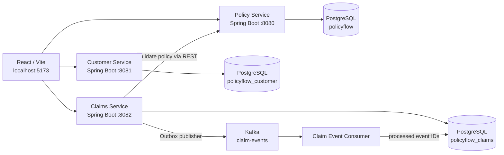

# PolicyFlow

PolicyFlow is a local learning project that models a small insurance workflow using Spring Boot microservices, PostgreSQL, Kafka, and a React/Vite frontend. It was built to practice the kinds of architecture and engineering discussions that arise in a senior Java / technical lead role: REST APIs, service boundaries, persistence, asynchronous messaging, reliability, idempotent consumers, integration testing, Docker, and operational troubleshooting.

> **Project status:** The core local demo flow has been exercised successfully. This is a learning/demo project, not a production-certified insurance platform. See [Known Gaps and Next Steps](docs/KNOWN_GAPS_AND_NEXT_STEPS.md) before treating it as production-ready.

## What it does

- Exposes policy, customer, and claims APIs.
- Uses a separate PostgreSQL database for each service.
- Validates a claim against the policy service before saving it.
- Writes the claim and a corresponding outbox event in the same database transaction.
- Publishes pending outbox events to Kafka asynchronously.
- Consumes `CLAIM_CREATED` events and records processed event IDs to prevent duplicate effects.
- Provides a React/Vite frontend for simple API connectivity testing and interaction.

## Architecture at a glance



The boxes represent logical services and data stores. The browser-facing local ports are mapped by Docker Compose; services communicate with one another using Compose service names on the internal Docker network.

## Services and local ports

| Component | Local address / port | Responsibility |
|---|---|---|
| React / Vite frontend | `http://localhost:5173` | Development UI and backend connectivity checks |
| Policy service | `http://localhost:8080` | Policy API and policy persistence |
| Customer service | `http://localhost:8081` | Customer API and customer persistence |
| Claims service | `http://localhost:8082` | Claim lifecycle, policy validation, transactional outbox |
| PostgreSQL | host port `55432` | Local database container; app services connect internally to port `5432` |
| Kafka | host port `9095` | Local access to Kafka; app containers use `kafka:9092` |

Database names seen in the local setup:

- `policyflow` — policy service database
- `policyflow_customer` — customer service database
- `policyflow_claims` — claims service database

The PostgreSQL role in the Compose setup is `policyflow`. Do not assume a default `postgres` role exists in this container.

## Prerequisites

- Docker Desktop with Docker Compose
- Java 17 and Maven for running/building services outside Docker and running Maven tests
- Node.js/npm for the React frontend
- Git

The observed local Java runtime was OpenJDK 17. Maven was installed through Homebrew. The Docker images used in the observed environment included PostgreSQL 17 and Apache Kafka 4.1.0. Check the repository's current Dockerfiles and Compose file for the versions actually pinned in your checkout.

## Run locally

Run these commands in **Mac Terminal**, from the repository root:

```bash
cd ~/Projects/PolicyFlow
docker compose up -d --build
docker compose ps
```

Wait until the services report healthy. First startup can take longer while images build and database migrations run.

Useful health checks:

```bash
curl -i http://localhost:8080/actuator/health
curl -i http://localhost:8081/actuator/health
curl -i http://localhost:8082/actuator/health
```

Stop containers without deleting persistent volumes:

```bash
docker compose stop
```

Start them again:

```bash
docker compose start
```

To stop and remove containers/network while keeping named volumes, use `docker compose down`. **Do not add `-v` unless you intentionally want to delete the Compose-managed database/Kafka volumes.**

## Basic API checks

```bash
# List policies
curl -i http://localhost:8080/api/policies

# List customers
curl -i http://localhost:8081/api/customers

# List claims
curl -i http://localhost:8082/api/claims
```

Create a test claim (use a unique claim number each time):

```bash
curl -i -X POST http://localhost:8082/api/claims \
  -H 'Content-Type: application/json' \
  -d '{
    "claimNumber": "CLM-2026-DOCS-001",
    "policyNumber": "POL-2026-1004",
    "customerId": "CUS-10001",
    "claimType": "AUTO_ACCIDENT",
    "claimAmount": 650.00
  }'
```

If that claim number already exists, choose a new unique value. If you see HTTP 401/403, inspect the current service security configuration and local environment variables; local auth settings may change during development. Do not paste passwords or tokens into Git, tickets, chat, or screenshots.

## Tests

The claims-service suite was run locally and reported `BUILD SUCCESS`. It includes tests for Kafka integration/consumer idempotency, outbox recovery from a simulated transient send failure, and transaction rollback when saving the outbox event fails. Run it from the repository root with:

```bash
cd ~/Projects/PolicyFlow/claims-service
mvn test
```

For test scope and the distinction between simulated publisher failure and a real Kafka container restart, read [Testing and Verification](docs/TESTING_AND_VERIFICATION.md).

## Documentation index

- [Architecture and Event Flow](docs/ARCHITECTURE.md)
- [Local Development and Operations](docs/LOCAL_DEVELOPMENT.md)
- [Testing and Verification](docs/TESTING_AND_VERIFICATION.md)
- [Known Gaps and Next Steps](docs/KNOWN_GAPS_AND_NEXT_STEPS.md)
- [Security and Git Checklist](docs/SECURITY_AND_GIT_CHECKLIST.md)

## Important design principle

The claims database is the source of truth for claim creation. The transactional outbox makes the database write and event record atomic; Kafka publication happens asynchronously. This avoids the dual-write failure where the claim commits but the event is lost (or the event is published even though the database transaction rolls back). Consumers still need idempotency because at-least-once delivery/retries can result in the same event being received more than once.
